# Seven Deadly Sins: Origin DPS Meter | SDS Meter

A real-time damage meter overlay for **Seven Deadly Sins: Origin** on Windows.
See how much damage everyone in your party deals, with a full breakdown per
hero and per skill, plus live enemy HP bars.

 

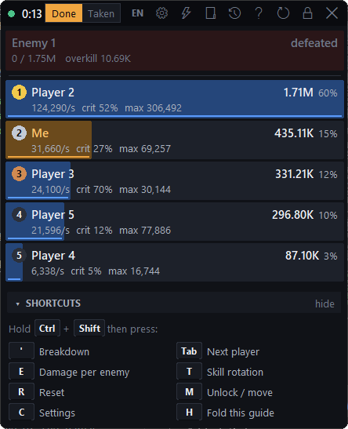

> **Passive and safe by design.** SDS Meter only *reads* the game's network
> traffic. It never touches the game process: no memory reading, no injection,
> no packet changes, no automation. The overlay is an ordinary separate window
> on top of the game.

---

## Support the project

If this tool has been useful to you, please consider supporting continued development:

Monthly or one-time: [patreon.com/sdsmeter](https://www.patreon.com/sdsmeter)

Your support keeps this project alive.

---

## Features

**Party damage, live**
- One row per player, ranked by damage, with total, DPS and share of the party.
  You are **Me** (orange bar); in dungeons and raids teammates are shown by
  their character name (Cfg > Display > **Player names**), otherwise as
  **Player 2**, **Player 3**, … keeping their number when the ranking changes.
- Switch between **damage done** and **damage taken**.
- The fight timer runs from the first to the last hit (heals don't stretch it).
  After **60 seconds** in which your party deals and takes no damage, the live
  meter clears itself; the fight stays in the fight history. Reset by hand any
  time (also saved), and change the 60 s in the settings (0 = off).
- **Boss mode:** when a boss dies, the fight ends there: the timer stops at the
  kill and a summary row shows the boss, the time to kill, party damage and DPS.
  The next fight starts with your party's next hit.

- **Guild boss (Demonic Beast Akumu):** its level (Lv 1-30) and how often it was
  killed (at 1 HP it comes back with full, higher HP instead of dying), and an
  **ULTIMATE** card: when it starts charging its big hit, a countdown to when it
  lands (also on the watch bar), and afterwards how much it dealt and to whom.
  A **SCORE** card follows your guild ranking points live during the run (1 point
  per 10,000 damage), with the server's exact score at each level-up and the
  final score when the run ends.

**Detailed breakdown**
- Open any player's panel to see damage per **hero** (with portraits; tag swaps
  are told apart) and per **skill**, each with the game's own skill icon: E, Q,
  Ultimate, passive, tag, normal and jump attacks, enchanted skills, combos and
  elemental bursts.
- Hits, average hit, crit rate, max hit and **overdamage** (damage wasted past
  the enemy's remaining HP).
- Gear set bonuses, weapon passives, pets, damage over time and elemental field
  effects are named the way the game names them.
- **Effects** (buffs and debuffs, by their in-game names in the meter's
  language), three ways:
  - **Live:** everything on you, your teammates and the enemies right now, with
    the time left, grouped by who it affects.
  - **Log:** every effect applied, in order, grouped by who put what on whom,
    with how long it lasted and whether it was re-applied while still on.
  - **Uptime:** how much of the fight each effect was up, one row per effect.
  - **Watch bar:** click any effect (or pick it by its icon) to watch it. A small
    bar always shows every watched effect: lit with its time left while it is on,
    dimmed while off, also effects the game itself doesn't show.
- **Graph tab:** damage over time for each player across the fight, with the
  boss's (or chosen enemy's) HP. *Combat data can be stored to improve the tool.*
- **Skill rotation:** every skill you cast, in order, with the key you pressed
  (the game's default keys: LMB, E, Q, R, Shift, 1-4) and the damage each cast
  dealt; a big view, or a small one with just the icons.

**Fight history**
- The fight going on is listed on top (**LIVE**), and every fight is saved when
  it ends (boss kill, reset, the 60 s idle clear, closing the meter), so it stays
  in the list after the main screen is cleared. Click one to see it again in the
  overlay, with its breakdown, effects, graph and rotation.
- **Export** a fight to a file to share it, and **Import** one (yours or a
  friend's) to look at it.

**Enemy HP bars**
- Every enemy your party hits gets a bar with its in-game name, HP %, HP left
  and max HP.
- **Damage to one enemy:** pick an enemy and the whole meter (players, DPS,
  breakdown) counts only the damage dealt to it. Useful for bosses with summons.

**Made to sit over the game**
- **Locked** mode is click-through and never takes focus from the game.
- Global hotkeys work while the game has focus.
- Adjustable opacity, icon size and text size (mini → giant), exact or short
  numbers (4,820,000 or 4.82M).
- English, Português (BR), Français and Deutsch.
- A short tutorial on the first start (open it again any time with **?**).

---

## Screenshots

<table>
<tr>
<td align="center" valign="top">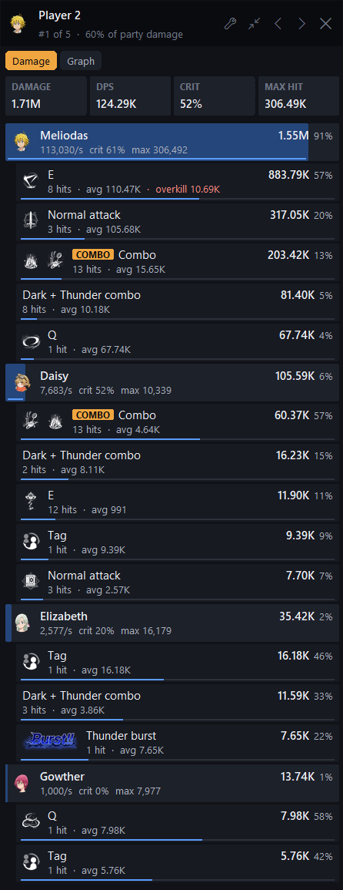 <b>Breakdown:</b> damage per hero and per skill</td>
<td align="center" valign="top">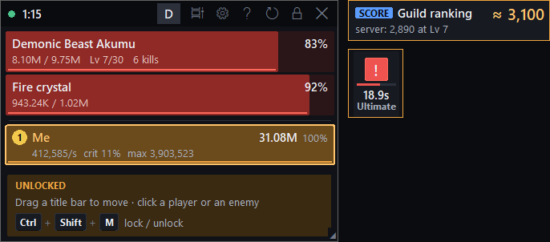 <b>Guild boss:</b> level, kills, the ultimate countdown and your score  
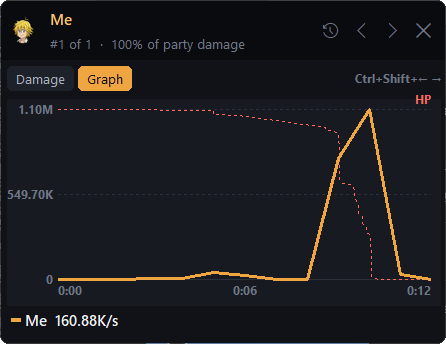 <b>Graph:</b> damage over time, with the boss's HP  
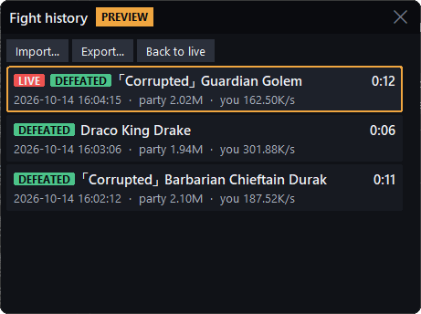 <b>Fight history:</b> every fight saved, the live one on top</td>
</tr>
<tr>
<td align="center" valign="top">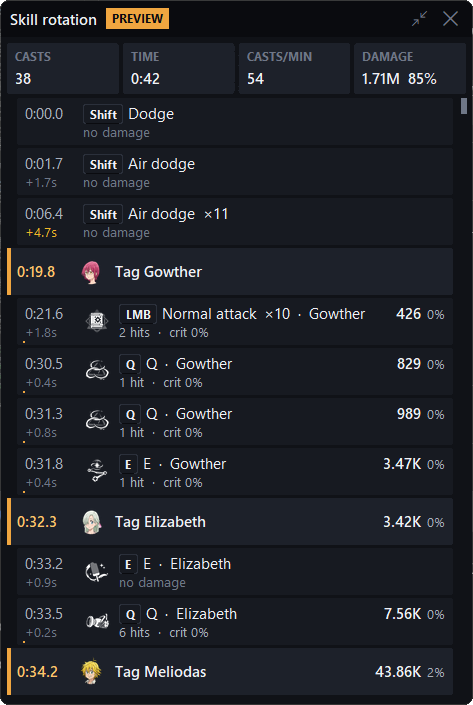 <b>Skill rotation:</b> every cast with its key, time and damage</td>
<td align="center" valign="top">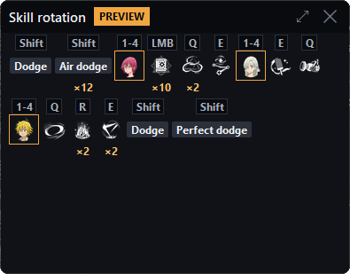 <b>Skill rotation, compact:</b> just the icons and keys  
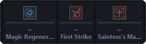 <b>Watch bar:</b> your tracked effects, always in view  
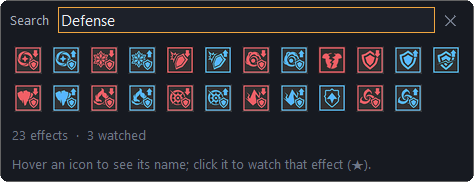 <b>Choose effects:</b> pick any effect by its icon</td>
</tr>
<tr>
<td align="center" valign="top">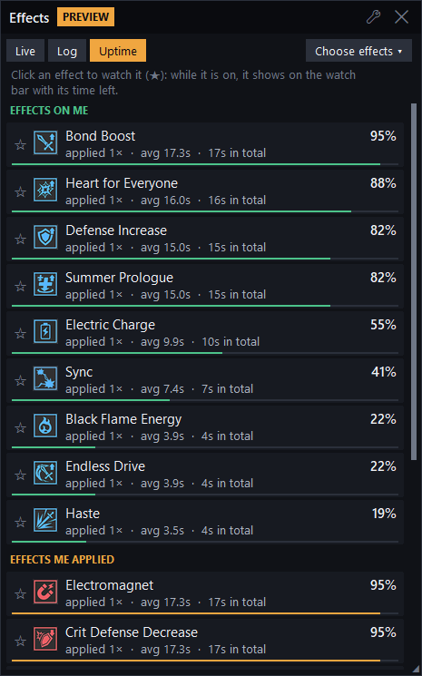 <b>Effects, Uptime:</b> how long each buff and debuff was up</td>
<td align="center" valign="top">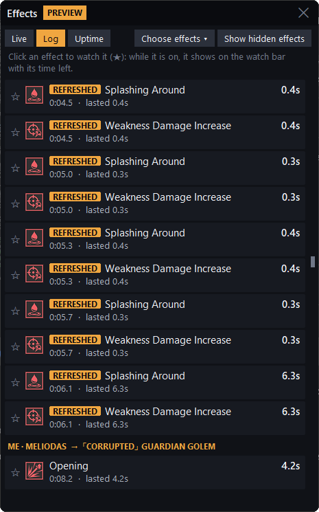 <b>Effects, Log:</b> who put what on whom, and when</td>
</tr>
</table>

---

## Requirements

- Windows 10 or 11
- **[Npcap](https://npcap.com/#download)**, the free capture driver Wireshark
  uses. If Wireshark is already installed, you already have it.
- The game in **windowed** or **borderless** mode (an overlay can't be drawn over
  exclusive fullscreen)

---

## Installation

1. **Install Npcap** from [npcap.com](https://npcap.com/#download) and keep the
   default options.
   - Leave *"Restrict Npcap driver's access to Administrators only"*
     **unchecked**. If you tick it, you have to run SDS Meter as administrator.
2. **Download** the latest `sds_meter.exe` from the [Releases](../../releases) page.
3. **Run** `sds_meter.exe`. No installer, nothing else to set up.
   - Windows SmartScreen may warn about an unknown publisher, because the exe
     isn't code-signed. Click **More info → Run anyway**.
4. **Start the game** (windowed or borderless) and get into a fight.

If Npcap is missing, SDS Meter tells you and offers to open the download page.

---

## How to use

1. Start SDS Meter, before or after the game.
2. The overlay shows **"Waiting for combat"** until damage happens. Hit
   something and the players appear.
3. Drag the title bar to move the overlay, then **lock** it (**Ctrl+Shift+M**)
   so clicks go through to the game. Its position is saved.
4. Press **Ctrl+Shift+'** for the breakdown, and **Ctrl+Shift+Tab** to go
   through the players.
5. Press **Ctrl+Shift+R** to reset between fights, or set an automatic reset in
   **⚙️**.

### How it works

The game client and server talk over the network, and the server tells your
client about every hit: who dealt it, to whom, with which skill, and for how
much. SDS Meter listens to that traffic through Npcap, decrypts the game's
messages, and adds the hits up per player, hero and skill. Your own character
is recognised from the stat sheets the server sends only to you, so teammates
playing the same heroes are never mistaken for you.

The decryption key is learned from the traffic itself and saved, so the meter
works straight away the next time; if a game update changes it, it is learned
again automatically.
Hits seen before the key is known are kept and counted once it is.

---

## Hotkeys

They work everywhere, including while the game has focus.

| Keys | Action |
|---|---|
| **Ctrl+Shift+'** | Open / close the breakdown of the first player |
| **Ctrl+Shift+Tab** or **Down** / **Up** | Next / previous player (while the breakdown is open) |
| **Ctrl+Shift+Left** / **Right** | Breakdown tabs: Damage, Graph (while it is open) |
| **Ctrl+Shift+M** | Lock / unlock the overlay (locked = click-through) |
| **Ctrl+Shift+R** | Reset the fight (when looking at a saved fight: back to the live one) |
| **Ctrl+Shift+E** | Damage to one enemy: cycle through the enemies, then back to all |
| **Ctrl+Shift+T** | Open / close the skill rotation |
| **Ctrl+Shift+C** | Open / close the settings |
| **Ctrl+Shift+H** | Collapse / expand the shortcut guide |

Outside the game the same keys also work without Ctrl+Shift (**'**, **Tab**, the arrows).
When the overlay is unlocked, you can also click a player to open their
breakdown, and click an enemy's bar to count only the damage dealt to it.

---

## Settings

Open them with **⚙️** in the title bar (or **Ctrl+Shift+C**). Every change
applies immediately and is saved.

- **Your details / Teammate details:** show each hero and/or each skill separately.
- **Display:** language, icon size, text size, exact numbers, opacity.
- **General:** enemy HP bars and how many, **boss mode**, monsters in damage
  taken, shortcut guide, start locked, max breakdown rows, **auto reset after N
  seconds idle** (60 by default), reset window positions.
- **Network adapter:** **All adapters (automatic)** by default. If you use a VPN
  or several network adapters and nothing shows up, pick the adapter you play on.
  A ● marks the one the game's traffic is coming in on.

---

## FAQ

**The meter says "Waiting for game traffic" and nothing appears.**
> Make sure the game is running and you're in a fight. In **⚙️ → Network
> adapter**, try picking the adapter you play on (VPNs like Radmin, Hamachi or
> ExitLag can get in the way). If you installed Npcap admin-only, run SDS Meter as
> administrator.

**I can't see the overlay over the game.**
> Set the game to **windowed** or **borderless** mode.

**My antivirus or SmartScreen flags the exe.**
> SDS Meter isn't code-signed and reads network traffic, which some antivirus
> programs treat as suspicious. It only listens for the game's traffic, and sends
> very little itself (see below).

**Can I get banned for this?**
> SDS Meter is passive: it doesn't touch the game's memory, files or traffic, and
> it doesn't automate anything. Still, it's a third-party tool, so use it at your
> own discretion.

**Some skills show text instead of an icon.**
> Skills with no icon of their own in the game files (some gear bonuses, combos,
> new skills) are written out. New heroes get their icons in the next update.

---

## Contact

Bug reports and suggestions: [GitHub Issues](../../issues) · Discord: `YOUR_DISCORD` · Email: `YOUR_EMAIL`

*SDS Meter is a fan-made tool and isn't affiliated with or endorsed by Netmarble.
Seven Deadly Sins: Origin and its assets belong to their respective owners.*
